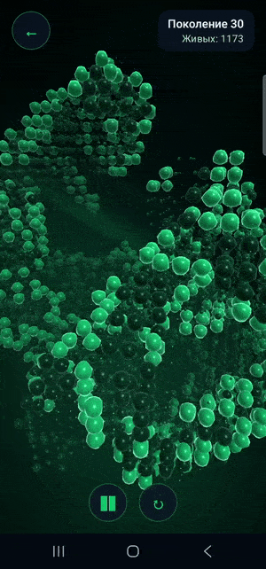
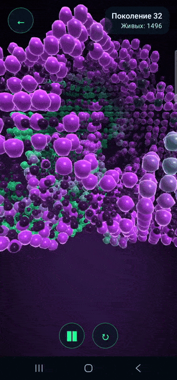

# Жизнь 3D

Игра «Жизнь» Конвея в трёх измерениях для Android на
[RedByteFX](https://github.com/i-redbyte/redbytefx) 1.2.0. Поколения считает compute-шейдер
OpenGL ES 3.1, написанный на Kotlin DSL библиотеки RedByteFX. Клетки рисуются инстансами сфер
в вязкой жидкости на OpenGL ES 3.0. Камера находится внутри среды, поэтому колония заполняет
экран, а не сидит в коробке.

[English version](README.md)

| Зацикленный тор · Изумруд · Лава | Бесконечное поле · Сияние · Лава |
| :---: | :---: |
|  |  |

## Возможности

- Два мира: зацикленный тор и бесконечное поле. В бесконечном поле окно симуляции следует
  за колонией, а по миру можно перемещаться одним пальцем.
- Семь правил в нотации Generations (B/S/C) по 26 соседям клетки: «Лава», «Риф», «Амёба», «Волны»,
  «Строитель», «Мох» и классическое 4555 Картера Бэйса. Если состояний больше двух, отмирающая клетка
  гаснет через несколько рефрактерных состояний: так появляются волны, оболочки и вымирающие колонии.
- Цвета клеток: семь однотонных, градиент «Сияние» и свой градиент. Свой градиент собирается
  в отдельном диалоге из оттенка, насыщенности и яркости.
- Настройки: размер поля (от 24³ до 64³), стартовые клетки (число или случайно) и скорость.
- Жесты: поворот, наклон, масштаб и тап, который рождает облако новой жизни.
- Русский и английский языки.

## Как устроено

| Часть | Где |
| --- | --- |
| Одно поколение как compute-шейдер: две решётки в одном storage-буфере, правила в uniform-блоке | [`gl/LifeCompute.kt`](app/src/main/java/ru/redbyte/life3d/gl/LifeCompute.kt) |
| Клетки и жидкость в одной программе GLES 3.0 | [`gl/LifeScene.kt`](app/src/main/java/ru/redbyte/life3d/gl/LifeScene.kt) |
| Эталон того же правила на CPU | [`domain/CpuLife.kt`](app/src/main/java/ru/redbyte/life3d/domain/CpuLife.kt) |
| Цикл поколений, чтение с GPU, следование окна | [`engine/LifeEngine.kt`](app/src/main/java/ru/redbyte/life3d/engine/LifeEngine.kt) |
| Клетки вокруг камеры со всеми видимыми копиями тора | [`domain/CellView.kt`](app/src/main/java/ru/redbyte/life3d/domain/CellView.kt) |
| Отрисовка кадра | [`engine/LifeRenderer.kt`](app/src/main/java/ru/redbyte/life3d/engine/LifeRenderer.kt) |

`GpuMatchesCpuTest` запускает compute-шейдер на устройстве и сверяет каждую клетку с CPU-эталоном
для всех правил и обоих миров.

## Требования

Android 7.0 (API 24) и новее с OpenGL ES 3.1. Эмулятор Android на Apple silicon даёт только
OpenGL ES 3.0, поэтому запускайте игру на устройстве или на эмуляторе со SwiftShader.

## Сборка

```bash
./gradlew :app:installDebug
```

Unit-тесты: `./gradlew :app:testDebugUnitTest`. GPU-тест на подключённом устройстве:
`./gradlew :app:connectedDebugAndroidTest`.
